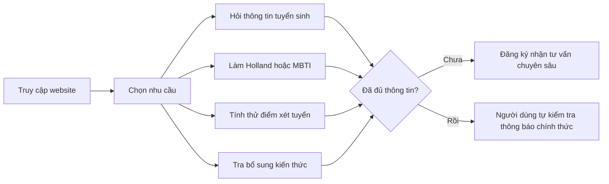

# 01. Tổng quan dự án

## Dự án giải quyết nhu cầu gì?

Người dự tuyển UEL thường cần tra nhiều thông báo để biết ngành học, điều kiện, học phí, lịch, điểm xét tuyển và yêu cầu dành cho sau đại học. Website gom các nhu cầu này vào một nơi. Khi chưa giải quyết được bằng thông tin có sẵn, người dùng có thể để lại thông tin để nhận tư vấn chuyên sâu.

## Ai dùng hệ thống?

| Nhóm | Mục tiêu thường gặp |
| --- | --- |
| Người dự tuyển đại học | Tìm ngành, hỏi hồ sơ/lịch/học phí, tính thử điểm, khám phá sở thích nghề nghiệp. |
| Người dự tuyển sau đại học | Tìm chương trình Thạc sĩ/Tiến sĩ, tra yêu cầu bổ sung kiến thức. |
| Phụ huynh | Tìm thông tin tuyển sinh thay hoặc cùng người dự tuyển. |
| Phòng Tuyển sinh và Công tác sinh viên | Tiếp nhận yêu cầu tư vấn cần người phụ trách trả lời. |
| Người phụ trách nội dung | Cung cấp và xác nhận tài liệu, bảng quy định, thông báo mới. |
| BA | Làm rõ quy tắc, nguồn dữ liệu, luồng ngoại lệ và tiêu chí nghiệm thu. |

## Hành trình tổng thể

Hành trình thực tế không bắt buộc theo một thứ tự cố định. Người dùng có thể chỉ dùng một chức năng. Trước khi dùng các chức năng tư vấn, họ có thể được hỏi nhanh về vai trò và trường đang/đã học để câu trả lời phù hợp hơn.

## Ranh giới cần phân biệt

- **Hỏi đáp tuyển sinh:** giúp tìm và diễn giải thông tin đã có; độ đúng phụ thuộc tài liệu đang có hiệu lực.
- **Holland/MBTI:** hỗ trợ tự hiểu sở thích và đặc điểm; không phải chẩn đoán hoặc quyết định chọn ngành.
- **Tính điểm:** tính thử từ điểm và quy tắc đang áp dụng trong hệ thống; không xác nhận đậu/rớt.
- **Bổ sung kiến thức:** tra danh mục theo bậc và ngành; hồ sơ cụ thể có thể cần người có thẩm quyền xác nhận.
- **Đăng ký tư vấn:** ghi nhận nhu cầu liên hệ; việc phân công và trả lời của nhân viên là bước tiếp theo ngoài luồng tự phục vụ.

Khi BA nghe yêu cầu như “chatbot trả lời sai”, bước đầu tiên là xác định **chức năng nào**, **câu hỏi/đầu vào nào**, **nguồn chính thức nào**, **kết quả mong đợi nào**. Không nên chốt yêu cầu chỉ từ một ảnh chụp câu trả lời.
