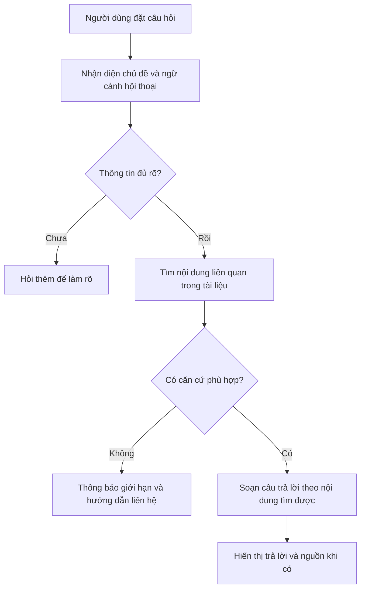

# 03. Quy trình hỏi đáp tuyển sinh

## Luồng chính

1. Người dùng gõ câu hỏi trong khu vực “Thông tin tuyển sinh”. Câu hỏi có thể về chương trình, FAQ hoặc lịch.
2. Hệ thống xét câu hỏi hiện tại cùng các lượt hỏi gần đây để hiểu ngữ cảnh. Ví dụ “ngành đó” phải được nối với ngành vừa nhắc trước đó.
3. Hệ thống tìm đoạn tài liệu có liên quan. Câu trả lời được diễn đạt từ các đoạn tìm được và có thể kèm **nguồn trích dẫn**.
4. Nếu câu hỏi thiếu bậc, ngành, năm hoặc nguồn không đủ rõ, kết quả phù hợp là hỏi lại hoặc nói rõ giới hạn. BA không nên kỳ vọng hệ thống tự suy đoán một con số chính thức.

## Quy tắc nội dung BA cần nắm

| Tình huống | Cách xử lý mong đợi |
| --- | --- |
| Hỏi lịch hoặc hạn chót | Nêu đúng ngày, đợt, năm và đối tượng áp dụng; không ghép mốc của hai thông báo khác nhau. |
| Hỏi học phí | Nêu đúng bậc/hệ/ngành/năm nếu tài liệu có phân biệt; nói rõ khi cần thêm thông tin. |
| Hỏi chương trình đào tạo | Phân biệt đại học, Thạc sĩ, Tiến sĩ và đúng ngành. |
| Hỏi FAQ | Trả lời ngắn, đúng trọng tâm; ưu tiên câu trả lời đã được đơn vị nghiệp vụ xác nhận. |
| Hỏi câu nối tiếp | Dùng ngữ cảnh còn liên quan; hỏi lại khi đại từ như “đó” có thể chỉ nhiều đối tượng. |
| Hỏi điểm xét tuyển cá nhân | Hướng người dùng sang phần tính điểm khi cần nhập đủ tham số. |
| Không thấy căn cứ đáng tin cậy | Không đưa số/ngày/điều kiện đoán; hướng kiểm tra thông báo chính thức hoặc đăng ký tư vấn. |

## Nguồn trích dẫn có ý nghĩa gì?

Nguồn giúp người dùng biết câu trả lời dựa vào tài liệu nào. Nó **không tự bảo đảm** tài liệu đó còn hiệu lực. Khi kiểm thử, BA cần xem nguồn có đúng chủ đề, đúng năm và hỗ trợ đúng câu trả lời hay không. Một câu trả lời nghe hợp lý nhưng trích nguồn sai vẫn là lỗi cần ghi nhận.

## Nếu cả FAQ và tài liệu đều có câu trả lời thì chọn nguồn nào?

**Hiện không có thứ tự cố định “luôn chọn FAQ” hoặc “luôn chọn tài liệu”.** Hệ thống tìm các đoạn liên quan từ cả hai nhóm, rồi xếp theo mức phù hợp với câu hỏi. Cách đặt câu hỏi, chủ đề, bậc học và năm có thể làm thứ tự thay đổi.

| Trường hợp | Cách hệ thống đang hướng tới |
| --- | --- |
| Có câu FAQ khớp sát và trả lời đủ | Ưu tiên dùng câu trả lời FAQ đó, tránh kéo thêm các câu FAQ khác chỉ gần chủ đề. |
| Người dùng cần bảng, danh sách, học phí hoặc chương trình chi tiết mà FAQ chỉ tóm tắt | Dùng phần tài liệu chi tiết phù hợp với nội dung được hỏi. |
| FAQ và tài liệu cùng nói một ý, không mâu thuẫn | Có thể dùng thông tin từ cả hai; nguồn hiển thị có thể gồm cả FAQ và tài liệu. |
| FAQ và tài liệu ghi **hai thông tin khác nhau** | Hệ thống **chưa có quy tắc nghiệp vụ chắc chắn** để tự chọn bản đúng chỉ dựa vào loại nguồn. BA phải xác định văn bản nào có hiệu lực, cho năm/bậc/đợt nào, rồi yêu cầu sửa hoặc ngừng dùng nội dung cũ. |

Ví dụ: FAQ ghi hạn nộp hồ sơ ngày 15/6, thông báo mới ghi ngày 20/6. Không nên kết luận chatbot phải lấy “FAQ” hay “tài liệu” chỉ từ tên loại nguồn. BA cần xác nhận thông báo nào đang có hiệu lực và FAQ đã được cập nhật hay chưa. **Danh sách nguồn hiển thị không đồng nghĩa hệ thống đã giải quyết đúng mâu thuẫn.**

## Hội thoại và lỗi thường gặp

Hệ thống giữ các lượt hỏi gần đây để trả lời tiếp. Khi người dùng bắt đầu cuộc hội thoại mới, câu hỏi cũ không nên ảnh hưởng câu trả lời mới. Nếu mạng lỗi, xử lý quá lâu hoặc người dùng gửi quá dồn dập, giao diện cần báo rõ tình trạng để người dùng biết có nên thử lại. BA nên kiểm thử cả câu hỏi đầu tiên, câu hỏi nối tiếp và câu hỏi chuyển chủ đề.

**Ví dụ test:** hỏi “Hạn nộp hồ sơ Thạc sĩ năm 2026 là ngày nào?” rồi hỏi “Nếu em nộp muộn thì sao?”. Expected result phải dựa trên đúng thông báo áp dụng cho Thạc sĩ năm 2026; nếu văn bản không nói về nộp muộn, hệ thống phải nói rõ chưa có căn cứ.
