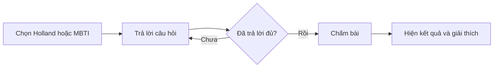

# 04. Trắc nghiệm định hướng và tính thử điểm xét tuyển

## A. Holland và MBTI

Người dùng vào “Khám phá tính cách”, chọn **một trong hai bài** và trả lời các câu hỏi. Chỉ khi trả lời đủ lượt câu hỏi hiện tại thì mới gửi bài. Nếu còn lượt tiếp theo, tiếp tục trả lời; khi hoàn thành, hệ thống chấm kết quả và hiển thị phần giải thích.

| Bài | Đáp án hợp lệ | Cách chấm đang dùng | Kết quả chính |
| --- | --- | --- | --- |
| Holland | Mỗi mục chọn số nguyên từ 1 đến 5 | Cộng điểm cho sáu nhóm RIASEC, xếp nhóm theo tổng điểm. | Nhóm cao nhất và ba nhóm nổi bật. |
| MBTI | Mỗi câu chọn A hoặc B | Đếm lựa chọn theo bốn cặp E/I, S/N, T/F, J/P; chọn bên có điểm cao hơn ở mỗi cặp. | Mã bốn chữ và số lựa chọn theo từng cặp. |

**Ngoại lệ cần kiểm thử:** bỏ trống đáp án thì chưa chấm; chọn ngoài thang thì báo lỗi; phiên làm bài hết hạn thì phải bắt đầu lại. Phần giải thích chỉ hỗ trợ định hướng, không chẩn đoán tâm lý và không khẳng định chắc chắn ngành phù hợp.

## B. Tính thử điểm xét tuyển

Người dùng chọn **năm xét tuyển**, **nhóm dữ liệu DT1–DT4**, khu vực và diện ưu tiên, sau đó nhập các điểm phù hợp. Hệ thống quy đổi về thang 100, tính các thành phần và trả kết quả có giải thích.

### Bước 1: Xác định dữ liệu nào cần dùng

| Nhóm | Dữ liệu dùng để tính điểm học lực |
| --- | --- |
| DT1 | ĐGNL + ba môn THPT + ba môn học bạ. |
| DT2 | Ba môn THPT + ba môn học bạ. |
| DT3 | ĐGNL + ba môn học bạ. |
| DT4 | Điểm chứng chỉ quốc tế (CCQT) đã quy đổi; có thể nhập SAT/ACT/IB/A-Level để hệ thống tra bảng. |

Giao diện có thể tự đổi DT1 sang DT2 khi xóa điểm ĐGNL và đổi lại DT1 khi nhập ĐGNL. DT3/DT4 do người dùng chọn riêng.

### Bước 2: Quy đổi điểm

- **X** = điểm ĐGNL thang 1200 × 100 / 1200.
- **Y** = tổng ba môn THPT thang 10 × 100 / 30.
- **Z** = tổng ba môn học bạ thang 10 × 100 / 30.
- Với **DT4**, điểm học lực là điểm CCQT quy đổi thang 100. Nếu có nhiều loại CCQT hợp lệ hoặc có cả điểm nhập tay, hệ thống chọn mức quy đổi cao nhất theo bảng đang áp dụng.

### Bước 3: Tính điểm học lực

Các hệ số α và β thay đổi theo năm xét tuyển. Công thức đang được hệ thống sử dụng:

| Nhóm | Công thức điểm học lực |
| --- | --- |
| DT1 | X × β1 + Y × β2 + Z × β3 |
| DT2 | (Y × α) × β1 + Y × β2 + Z × β3 |
| DT3 | X × β1 + X × β2 + Z × β3 |
| DT4 | Điểm CCQT quy đổi thang 100 |

Ví dụ, bộ hệ số **năm 2026** hiện dùng α = 1, β1 = 0,55, β2 = 0,35, β3 = 0,10. BA cần xác nhận lại hệ số và văn bản khi kiểm thử kỳ tuyển sinh khác.

### Bước 4: Cộng điểm và ưu tiên

**Điểm cộng** có thể đến từ chứng chỉ tiếng Anh, trường THPT thuộc danh sách ưu tiên và khoản cộng khác nếu quy định cho phép. Với cấu hình năm 2026 hiện dùng, trường trong danh sách 149 trường được cộng 5 điểm; tổng điểm cộng được giới hạn tối đa 10. Việc tra trường phải dựa trên đúng danh sách và mã trường được áp dụng, tránh suy từ tên trường gần giống.

**Điểm ưu tiên** được tra từ khu vực (KV) và diện ưu tiên (UT). Khi **điểm học lực + điểm cộng ≥ 75**, điểm ưu tiên được điều chỉnh theo công thức: `(100 − điểm học lực − điểm cộng) / 25 × điểm ưu tiên theo bảng`. Dưới ngưỡng đó, cách xử lý hiện tại là lấy nguyên điểm theo bảng; đây là quy tắc cần xác nhận lại khi quy chế thay đổi.

**Tổng điểm xét tuyển = điểm học lực + điểm cộng + điểm ưu tiên**, tối đa 100 điểm. Kết quả có thể kèm cảnh báo: thiếu đầu vào, điểm THPT dưới ngưỡng gợi ý, tổng điểm cộng chạm trần, trường ưu tiên không khớp danh sách hoặc tổng trước trần vượt 100.

### Điểm BA cần nêu trong test case

- Giao diện hiện tại **vẫn cho tính khi ô điểm còn trống**: ô trống được tạm dùng như 0 và có cảnh báo. Vì vậy cần test cả trường hợp đủ và thiếu dữ liệu.
- Một cảnh báo về điều kiện đầu vào **không phải** quyết định loại hồ sơ.
- Kết quả chỉ là **tính thử**. Không ghi expected result là “đậu” hoặc “rớt” nếu chưa có quy tắc và dữ liệu xét tuyển chính thức.
- Khi có chứng chỉ tiếng Anh hoặc CCQT, BA cần cung cấp bảng quy đổi đúng kỳ tuyển sinh để so sánh kết quả.
