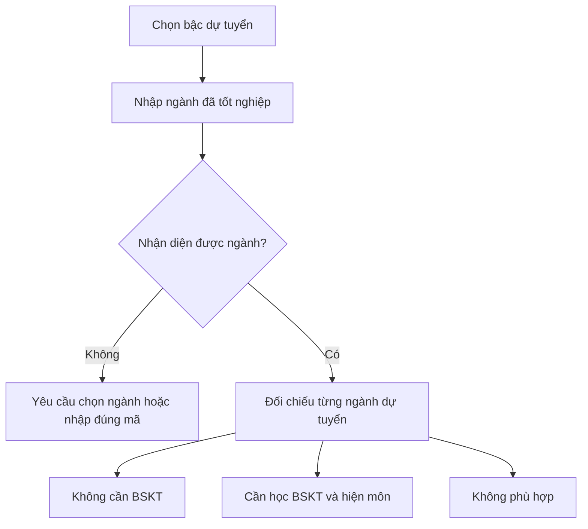

# 05. Tra cứu bổ sung kiến thức sau đại học

## Người dùng cần trả lời câu hỏi gì?

Người đã tốt nghiệp một ngành muốn dự tuyển Thạc sĩ hoặc Tiến sĩ tại UEL. Họ cần biết với bằng đã có, **ngành dự tuyển nào không cần BSKT**, **ngành nào cần học BSKT**, và **ngành nào không phù hợp** theo danh mục đang áp dụng. BSKT là “bổ sung kiến thức”.

## Luồng tra cứu trên website

1. Chọn bậc muốn dự tuyển: **Thạc sĩ** hoặc **Tiến sĩ**.
2. Nhập **tên hoặc mã 7 số của ngành đã tốt nghiệp**. Khi chọn Thạc sĩ, hệ thống gợi ý ngành tốt nghiệp Đại học; khi chọn Tiến sĩ, gợi ý ngành tốt nghiệp Thạc sĩ.
3. Nếu tên/mã chưa nhận diện được, hệ thống yêu cầu chọn ngành trong danh sách gợi ý hoặc nhập đúng mã. Chưa có kết luận ở bước này.
4. Khi nhận diện được ngành, hệ thống so với **từng ngành dự tuyển** ở bậc đã chọn, rồi hiển thị một bảng kết quả. Người dùng không phải chọn sẵn một ngành dự tuyển để xem bảng.

## Ba trạng thái kết quả

| Trạng thái | Người dùng nên hiểu | Thông tin hiện thêm |
| --- | --- | --- |
| **Không cần BSKT** | Ngành tốt nghiệp thuộc nhóm được miễn bổ sung với ngành dự tuyển đó. | Tên ngành dự tuyển. |
| **Cần học BSKT** | Có thể xem xét dự tuyển nhưng phải học các môn bổ sung theo danh mục. | Danh sách môn phải bổ sung nếu có. |
| **Không phù hợp** | Ngành đã tốt nghiệp không nằm trong hai nhóm trên theo bảng tra hiện tại. | Tên ngành dự tuyển để người dùng đối chiếu. |

Bảng được sắp để các ngành **không cần BSKT** lên trước, tiếp theo là **cần học BSKT**, sau cùng là **không phù hợp**. Phần tóm tắt đếm số ngành ở từng trạng thái.

## Ranh giới nghiệp vụ

Kết quả trên website là **tham khảo từ danh mục**, không phải kết quả xét hồ sơ cuối cùng. Sau khi nộp hồ sơ, chuyên viên phụ trách sẽ rà soát theo quy định. BA cần yêu cầu đơn vị nghiệp vụ xác nhận danh mục ngành, mã ngành, môn bổ sung, năm áp dụng và cách xử lý ngành không có trong danh mục.

**Ví dụ test:** chọn bậc Thạc sĩ, nhập một mã ngành Đại học hợp lệ. Kiểm tra tên ngành được nhận diện, số lượng kết quả ở ba trạng thái và môn của ít nhất một ngành “Cần học BSKT”. Đổi sang bậc Tiến sĩ phải làm mới đầu vào để tránh dùng nhầm ngành Đại học làm ngành tốt nghiệp Thạc sĩ.
