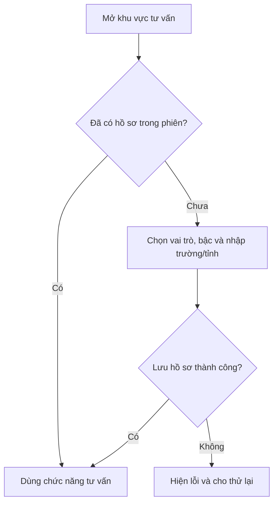
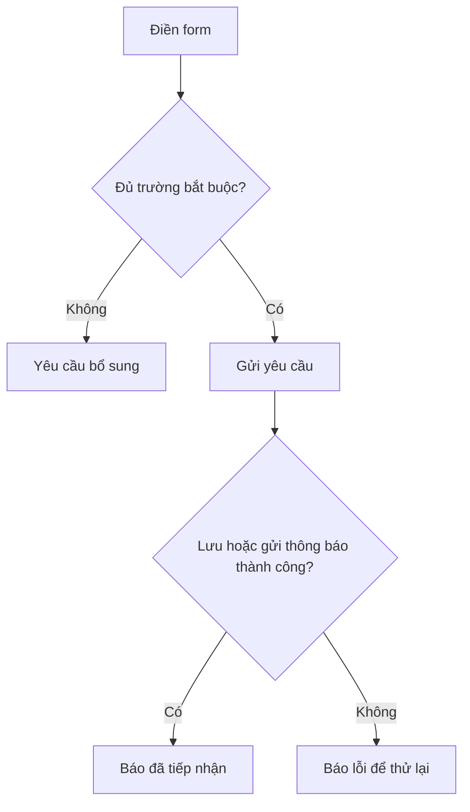

# 06. Khảo sát nhanh và đăng ký nhận tư vấn

Hai bước này dễ bị nhầm vì đều hỏi thông tin người dùng. **Khảo sát nhanh** giúp cá nhân hóa lúc dùng bot. **Đăng ký tư vấn** là yêu cầu để đơn vị tuyển sinh liên hệ sau.

## A. Khảo sát nhanh trước khi dùng bot

Lần đầu mở khu vực tư vấn trong một phiên trình duyệt, người dùng được hỏi là **người dự tuyển** hay **phụ huynh**. Người dự tuyển chọn tiếp bậc Đại học hoặc Sau đại học. Sau đó nhập tên trường đang/đã học và tỉnh/thành. Với nhu cầu Đại học hoặc phụ huynh, hệ thống có thể gợi ý trường THPT khi gõ tên.

Hồ sơ dùng để xưng hô phù hợp (“Chào bạn” hoặc “Kính chào Quý phụ huynh”) và cung cấp ngữ cảnh cho câu trả lời. Đây **không phải bước xác minh danh tính**. Nếu bước kiểm tra chống bot được bật, người dùng phải hoàn tất kiểm tra trước khi tiếp tục. Nếu lưu hồ sơ thất bại, hộp khảo sát vẫn hiện và cần báo lỗi rõ ràng.

## B. Đăng ký nhận tư vấn chuyên sâu

Người dùng nhập **họ tên, email, điện thoại, bậc đào tạo quan tâm**; ghi chú là tùy chọn. Bậc quan tâm giúp đơn vị tuyển sinh chuyển yêu cầu đến đúng người. Các trường bắt buộc cần được kiểm tra trước khi gửi.

Khi gửi, hệ thống thử **lưu bản đăng ký** và/hoặc **gửi thông báo cho người phụ trách**. Chỉ cần một kênh thành công, yêu cầu được báo là đã tiếp nhận. Nếu cả hai kênh thất bại, người dùng phải nhận thông báo gửi không thành công. Nếu đã lưu nhưng thông báo chưa gửi được, hệ thống có thể báo tiếp nhận kèm cảnh báo.

**Đã tiếp nhận** không có nghĩa đã được tư vấn xong. Quy trình phân công, thời gian phản hồi, trạng thái xử lý và cách đóng yêu cầu cần được Phòng Tuyển sinh và Công tác sinh viên xác nhận nếu dự án mở rộng sang quản lý lead.

## C. Những loại thông tin cần phân biệt

| Loại thông tin | Dùng để làm gì? | Câu hỏi BA cần đặt ra |
| --- | --- | --- |
| Hồ sơ khảo sát nhanh | Cá nhân hóa cách tư vấn | Có cần sửa/xóa hồ sơ khi người dùng chọn nhầm vai trò không? |
| Nội dung hội thoại | Hiểu câu hỏi nối tiếp và xem lại lịch sử | Ai được xem lịch sử, giữ trong bao lâu? |
| Đáp án/kết quả trắc nghiệm | Chấm bài và giải thích | Người dùng có cần xem lại hoặc xóa kết quả không? |
| Điểm nhập để tính thử | Tạo kết quả trên màn hình | Có được lưu điểm hay chỉ lưu số lần dùng công cụ? |
| Thông tin đăng ký tư vấn | Để liên hệ | Ai tiếp nhận, phản hồi trong bao lâu, cách tránh đăng ký trùng? |

Khi viết yêu cầu mới liên quan dữ liệu cá nhân, BA phải hỏi rõ mục đích, người được xem, thời hạn lưu và cách người dùng yêu cầu sửa/xóa. Không tự suy ra các quy định này từ giao diện hiện có.
