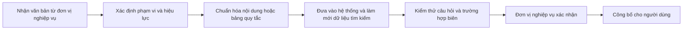

# 07. Nguồn thông tin và quy trình cập nhật nội dung

## Vì sao cùng một câu hỏi có thể trả lời khác nhau?

Câu trả lời phụ thuộc vào **tài liệu đang có**, **đoạn được tìm thấy** và **cách diễn đạt từ đoạn đó**. Các bảng tính điểm và bổ sung kiến thức còn phụ thuộc vào **quy tắc/danh mục đang áp dụng**. Khi một kết quả sai, BA cần tìm nguyên nhân trước khi đề xuất cách sửa.

| Dấu hiệu | Nguyên nhân cần kiểm tra |
| --- | --- |
| Trả số liệu cũ | Tài liệu cũ chưa được thay, hoặc tài liệu mới chưa có hiệu lực trong hệ thống. |
| Trích đúng file nhưng sai đoạn | Cách chia/tìm đoạn chưa phù hợp; câu hỏi có thể quá chung. |
| Đoạn đúng nhưng câu trả lời diễn giải sai | Cách tổng hợp hoặc quy tắc diễn đạt cần điều chỉnh. |
| Điểm tính khác văn bản | Hệ số, bảng quy đổi, cách áp trần hoặc năm xét tuyển cần kiểm tra. |
| BSKT xếp sai nhóm | Mã ngành, danh mục miễn/cần học hoặc bậc dự tuyển chưa khớp. |

## Quy trình cập nhật nội dung

### 1. Nhận và xác định nguồn

Ghi tên văn bản, đơn vị ban hành, ngày ban hành, ngày có hiệu lực, năm tuyển sinh, bậc học và phương thức xét tuyển áp dụng. Nếu là bảng tính điểm hoặc BSKT, ghi rõ đây là **bản thay thế** hay **bản bổ sung**.

### 2. Xác định phần bị ảnh hưởng

Tài liệu có thể ảnh hưởng phần hỏi đáp, lịch, công thức tính điểm, bảng chứng chỉ hoặc bảng BSKT. Một thông báo mới đôi khi ảnh hưởng **nhiều chức năng**. Ví dụ thay đổi điểm cộng tiếng Anh cần sửa cả lời giải thích và kết quả tính thử.

### 3. Chuẩn hóa và đưa vào sử dụng

Giữ tiêu đề, bảng, đơn vị đo, mốc thời gian và ghi chú quan trọng. Cần làm mới dữ liệu tìm kiếm trước khi kiểm thử. **Có file mới không có nghĩa chatbot đã dùng file mới.** Nếu văn bản cũ hết hiệu lực, cần quyết định cách lưu trữ hoặc loại khỏi câu trả lời hiện hành.

### 4. Kiểm thử và xác nhận

Mỗi thay đổi nên có ít nhất: một câu hỏi trực tiếp, một cách hỏi khác nghĩa tương đương, một câu hỏi nối tiếp và một trường hợp dễ nhầm với văn bản cũ. Với công thức/bảng, thêm giá trị ở ranh giới: vừa dưới ngưỡng, đúng ngưỡng và vừa trên ngưỡng. Đơn vị nghiệp vụ xác nhận câu trả lời và ví dụ số trước khi công bố.

## Khi nhiều nguồn mâu thuẫn

BA không tự chọn theo cảm tính. Cần hỏi người phụ trách: văn bản nào có hiệu lực, áp dụng cho nhóm người dùng nào, văn bản cũ bị thay toàn bộ hay chỉ một phần. Ghi quyết định này vào yêu cầu và expected result. Ví dụ FAQ nói một hạn nộp hồ sơ, thông báo mới nói hạn khác: cần xác định đúng **đợt tuyển sinh**, **bậc học** và **ngày hiệu lực** trước khi kết luận lỗi.

FAQ khớp sát có thể được ưu tiên khi trả lời câu hỏi ngắn; tài liệu chi tiết có thể được ưu tiên khi người dùng hỏi bảng hoặc quy định cụ thể. Đây là cách **chọn nội dung phù hợp**, không phải quy tắc xác định văn bản nào có giá trị cao hơn khi hai nguồn mâu thuẫn. Nếu muốn hệ thống luôn ưu tiên một loại văn bản trong tình huống cụ thể, BA phải mô tả rõ điều kiện, phạm vi áp dụng và người phê duyệt quy tắc đó.

## Mẫu phiếu thay đổi nội dung

| Mục | Cần ghi |
| --- | --- |
| Nội dung thay đổi | Quy tắc hoặc thông tin mới là gì? |
| Nguồn chính thức | Văn bản, đơn vị, ngày hiệu lực. |
| Phạm vi | Chức năng, năm, bậc học, nhóm người dùng. |
| Nội dung cũ | Giữ, sửa hay ngừng dùng? |
| Ví dụ kiểm thử | Đầu vào và kết quả mong đợi cụ thể. |
| Người xác nhận | Chuyên viên hoặc đơn vị chịu trách nhiệm nghiệp vụ. |

Nếu chưa có nguồn hoặc người xác nhận, đánh dấu yêu cầu là **cần làm rõ** thay vì biến một giả định thành quy tắc chính thức.
