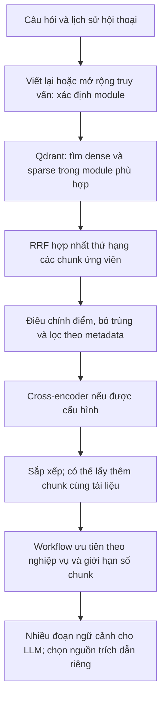

# 09. Qdrant chọn chunk nào khi nhiều tài liệu cùng được tìm thấy?

## Câu trả lời ngắn

Hệ thống **không chọn một tài liệu duy nhất**. Mỗi tài liệu được chia thành các *chunk* (đoạn). Qdrant tìm nhiều chunk ứng viên bằng hai cách: gần nghĩa với câu hỏi (*dense*) và trùng từ quan trọng (*sparse*). Hệ thống hợp nhất thứ hạng, điều chỉnh điểm theo loại nội dung, bậc đào tạo, ngành và nguồn, rồi đưa **một số chunk đứng đầu** vào ngữ cảnh cho mô hình soạn câu trả lời. Chunk đứng đầu cũng có thể được dùng để lấy thông tin liên hệ; các nguồn hiển thị được chọn riêng từ danh sách kết quả.

Tài liệu này mô tả **đường xử lý khi bật `RAG_VECTOR_BACKEND=qdrant`**. Nếu Qdrant không được bật hoặc khởi tạo thất bại, hệ thống dùng nhánh FAISS/keyword; cách tính điểm của nhánh đó khác. Xem [RAGService](https://gitlab.com/thaihongdanh93/n2nai_chatbot_tvts/-/blob/main/chatbot-api/services/rag_service.py) và [QdrantVectorStore](https://gitlab.com/thaihongdanh93/n2nai_chatbot_tvts/-/blob/main/chatbot-api/services/qdrant_service.py).

## Đường đi của một câu hỏi

### 1. Xác định phạm vi tìm kiếm

Trước khi gọi Qdrant, workflow có thể nối ngữ cảnh cho câu hỏi tiếp nối, mở rộng từ khóa ngành/bậc hoặc dùng router của `module_1` để gợi ý file và cấp đào tạo. `RAGService.search()` còn chuẩn hóa tên module và bổ sung truy vấn theo module. Ví dụ các mode `module_1_1`, `module_1_2`, `module_1_3` cùng ánh xạ dữ liệu về `module_1`. Khi có `data_module`, Qdrant chỉ tìm các điểm có metadata `data_module` tương ứng. Đây là **lọc trước khi xếp hạng**, giúp tài liệu của chủ đề khác không chiếm chỗ ứng viên. Xem [workflow `_retrieve_node`](https://gitlab.com/thaihongdanh93/n2nai_chatbot_tvts/-/blob/main/chatbot-api/services/langgraph_workflow.py) và [ánh xạ module](https://gitlab.com/thaihongdanh93/n2nai_chatbot_tvts/-/blob/main/chatbot-api/services/bot_model_config.py).

### 2. Lấy nhiều ứng viên từ Qdrant

Qdrant chạy hai truy vấn trong một lần gọi: vector dense tìm đoạn gần về ngữ nghĩa; vector sparse dựa trên tần suất từ và IDF tìm đoạn có từ khóa khớp. **Reciprocal Rank Fusion (RRF)** hợp nhất *thứ hạng* của hai danh sách. Một chunk có thứ hạng tốt ở cả hai phía thường được đẩy lên cao. Số ứng viên là `max(top_k × 4, 32)` cho mỗi nhánh và kết quả hợp nhất. Trong workflow, `top_k` ban đầu thường là **48 khi có module dữ liệu**, hoặc **12 khi không có**. Nếu collection thiếu sparse vector, hoặc truy vấn hybrid lỗi, Qdrant chuyển sang tìm dense; đường fallback này chỉ lấy tối đa `top_k` ứng viên. Xem [`_native_hybrid_search`](https://gitlab.com/thaihongdanh93/n2nai_chatbot_tvts/-/blob/main/chatbot-api/services/qdrant_service.py) và [`_dense_search`](https://gitlab.com/thaihongdanh93/n2nai_chatbot_tvts/-/blob/main/chatbot-api/services/qdrant_service.py).

RRF cho biết mức ưu tiên *tương đối* giữa các chunk được tìm thấy. Điểm này **không phải xác suất câu trả lời đúng**, và điểm sau các bước điều chỉnh cũng không nên đem so trực tiếp giữa những câu hỏi khác nhau.

### 3. Chấm lại trong ứng dụng

Sau khi Qdrant trả kết quả, Python điều chỉnh thứ tự theo câu hỏi và metadata:

| Tín hiệu | Tác động lên thứ hạng |
| --- | --- |
| FAQ khớp sát câu hỏi | Tăng điểm FAQ theo mức trùng từ; gộp bản `faq` có cả hỏi–đáp với bản `faq_question` trùng; nếu có FAQ rất khớp, có thể giảm điểm đoạn CTĐT. |
| Bậc đào tạo | Câu hỏi nêu một bậc rõ ràng thì chunk đúng bậc được tăng điểm, chunk thuộc bậc khác bị giảm. Nếu hỏi so sánh từ hai bậc trở lên thì không giảm chéo. |
| Tên ngành | Nếu truy vấn đã xác định “Cử nhân/Thạc sĩ/Tiến sĩ ngành X”, chunk có `metadata.program` khớp ngành X được tăng điểm; ngành bị nêu rõ là “không phải” được giảm điểm. |
| Bảng hoặc phụ lục | Câu hỏi về danh sách 149 trường, chứng chỉ tiếng Anh hoặc chứng chỉ quốc tế có thể đẩy chunk của phụ lục tương ứng lên. |
| Router tài liệu `module_1` | Có thể lọc theo bậc, tên file hoặc chuỗi nguồn. Nếu sau lọc còn dưới 3 chunk, hệ thống quay lại danh sách chưa lọc để tránh mất hết ngữ cảnh. |

Các quy tắc nằm trong [`_faq_boost`, `_level_boost`, `_program_name_boost`, `_appendix_boost`, `_apply_router_filter`](https://gitlab.com/thaihongdanh93/n2nai_chatbot_tvts/-/blob/main/chatbot-api/services/qdrant_service.py). **Cross-encoder chỉ chạy khi có `RAG_RERANKER_MODEL`**; khi đó nó chấm cặp `(câu hỏi, nội dung chunk)` cho tối đa `RAG_RERANKER_TOP_N` ứng viên (mặc định 20), rồi hệ thống sắp xếp lại. Không nên mô tả cross-encoder là bước luôn có trong mọi lần hỏi.

### 4. Bổ sung đoạn cùng tài liệu và cắt danh sách

Sau khi sắp xếp, nếu tìm được chunk dạng `section` từ một file CTĐT không phải FAQ, có `score ≥ 0,3` và có đường dẫn nguồn, hệ thống có thể lấy thêm **tối đa 20 chunk cùng file**. Những đoạn cùng file được gán điểm bằng `0,85 × điểm của chunk kích hoạt`; một số đoạn cùng ngành ở bậc khác có thể được thêm với `0,7 × điểm đó`. Sau đó Qdrant sắp xếp lại và chỉ trả về `top_k`. Cơ chế này nhằm tránh trường hợp tìm đúng một mục CTĐT nhưng thiếu các mục kế tiếp cần để trả lời đầy đủ. Xem [`_source_complete`](https://gitlab.com/thaihongdanh93/n2nai_chatbot_tvts/-/blob/main/chatbot-api/services/qdrant_service.py).

Workflow còn áp dụng ưu tiên nghiệp vụ **sau Qdrant**. Với `module_1`, nó có thể đưa tài liệu đúng ngành/bậc, bảng học phí hoặc nội dung ký túc xá lên trước, bỏ trùng, rồi giới hạn ngữ cảnh (mặc định tối đa 25 chunk cho chế độ CTĐT tổng hợp; các nhánh khác có giới hạn riêng). `module_2` ưu tiên tài liệu Holland/MBTI và mặc định lấy tối đa 14 chunk; `module_3` mặc định lấy tối đa 8. Nếu hai kết quả đầu ở `module_1` gần điểm nhau và giống chủ đề nhưng khác ý, hệ thống **có thể hỏi lại người dùng** thay vì tự chọn một nghĩa. Xem [workflow chọn ngữ cảnh](https://gitlab.com/thaihongdanh93/n2nai_chatbot_tvts/-/blob/main/chatbot-api/services/langgraph_workflow.py), [pin theo bậc/ngành](https://gitlab.com/thaihongdanh93/n2nai_chatbot_tvts/-/blob/main/chatbot-api/services/module_1_catalog.py) và [ưu tiên module 2](https://gitlab.com/thaihongdanh93/n2nai_chatbot_tvts/-/blob/main/chatbot-api/services/module_2_rag.py).

**Kết quả cuối:** LLM nhận danh sách nhiều đoạn ngữ cảnh; `search_results[0]` là kết quả đứng đầu *sau cả bước ưu tiên của workflow*, không nhất thiết là chunk có điểm RRF gốc cao nhất. Danh sách nguồn trích dẫn thường xét các kết quả đầu (tối đa 5), nhưng có logic chọn nguồn riêng; **nguồn hiển thị không phải bằng chứng LLM chỉ dùng đúng một chunk đó**. Xem [tạo `context` và `citations`](https://gitlab.com/thaihongdanh93/n2nai_chatbot_tvts/-/blob/main/chatbot-api/services/langgraph_workflow.py).

## Ví dụ để BA hình dung

Người dùng hỏi: **“Học phí Thạc sĩ Kế toán năm 2026 là bao nhiêu?”**

1. Hệ thống tìm được các chunk từ FAQ học phí, tài liệu Thạc sĩ Kế toán, thông báo tuyển sinh và có thể cả tài liệu Đại học Kế toán.
2. RRF xếp hạng các đoạn gần nghĩa và khớp từ khóa. Quy tắc bậc đào tạo hạ đoạn Đại học; nếu truy vấn được bổ sung cụm “Thạc sĩ ngành Kế toán”, quy tắc tên ngành có thể nâng đoạn khớp ngành Kế toán. FAQ sát câu hỏi có thể được nâng, nhưng bước ưu tiên học phí của workflow có thể đưa bảng/mục học phí chi tiết lên trước.
3. Một số chunk đứng đầu được đưa vào ngữ cảnh. Nếu tài liệu không ghi rõ học phí áp dụng cho **năm 2026**, điểm tìm kiếm cao vẫn **không đủ căn cứ** để khẳng định con số của năm đó.

Ví dụ minh họa cơ chế, **không khẳng định dữ liệu hoặc thứ hạng thực tế** của câu hỏi này. Thứ hạng phụ thuộc tài liệu đã ingest, metadata, cấu hình và nội dung truy vấn.

## BA kiểm thử và ghi nhận lỗi như thế nào?

| Cần kiểm tra | Câu hỏi khi đọc kết quả |
| --- | --- |
| Đúng phạm vi | Chunk được chọn có đúng ngành, bậc, năm và loại thông báo không? |
| Đủ căn cứ | Các đoạn được đưa vào ngữ cảnh có chứa chính con số/điều kiện cần trả lời không? Có thiếu trang hoặc mục kế tiếp của cùng file không? |
| FAQ và tài liệu chi tiết | FAQ có chỉ trả lời tóm tắt trong khi người dùng yêu cầu bảng hoặc quy định đầy đủ không? |
| Nguồn trích dẫn | Nguồn hiển thị có thật sự hỗ trợ câu trả lời không? Có đang trỏ sang bậc hoặc năm khác không? |
| Hai tài liệu mâu thuẫn | Văn bản nào có hiệu lực cho đối tượng và kỳ tuyển sinh đang hỏi? BA cần xác nhận nghiệp vụ; điểm retrieve không tự giải quyết hiệu lực văn bản. |

Khi báo lỗi, ghi **câu hỏi nguyên văn, mode, tài liệu/chunk mong đợi, tài liệu/chunk thực nhận, năm/bậc/ngành áp dụng và câu trả lời đã hiển thị**. Như vậy nhóm kỹ thuật có thể xác định lỗi xảy ra ở dữ liệu ingest, metadata, bước tìm kiếm, bước xếp hạng hay bước soạn câu trả lời.
